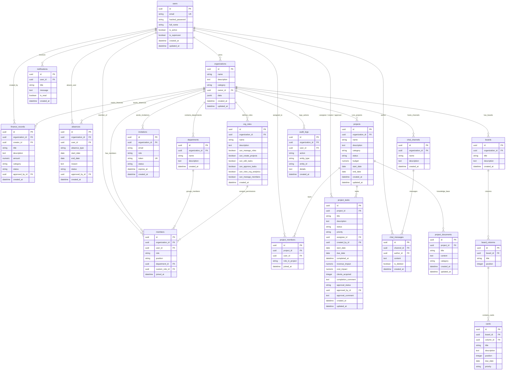

# Диаграмма сущностей и связей (Entity-Relationship Diagram, ER-D) — Платформа «Сопрано»

> Документ содержит полную схему реляционной базы данных платформы «Сопрано» (PostgreSQL / SQLAlchemy 2.0 Async), описание сущностей, первичных (PK) и внешних (FK) ключей, типов данных и правил целостности.

---

## 1. ER-диаграмма базы данных (Mermaid ERD)

---

## 2. Описание ключевых таблиц и атрибутов

### 2.1. `projects` (Проекты организации)
Проекты представляют собой независимые направления деятельности организации (IT-разработка, бизнес-аналитика, маркетинг, HR, логистика и т.д.):
- `id` (UUID, PK) — уникальный идентификатор проекта.
- `organization_id` (UUID, FK -> `organizations.id`, `ON DELETE CASCADE`) — ссылка на родительскую организацию.
- `name` (VARCHAR(200), NOT NULL) — наименование проекта.
- `description` (TEXT, NULL) — развернутые цели, стейкхолдеры и критерии успеха.
- `category` (VARCHAR(50), NOT NULL, default='development') — категоризация (`development`, `business_analysis`, `marketing`, `hr`, `logistics`, `finance`, `other`).
- `status` (VARCHAR(30), NOT NULL, default='active') — статус проекта (`planning`, `active`, `paused`, `completed`, `archived`).
- `budget` (NUMERIC(14, 2), NOT NULL, default=0.0) — выделенный бюджет проекта.
- `start_date` / `end_date` (DATE, NULL) — плановые даты старта и завершения.

### 2.2. `project_tasks` (Задачи проекта)
Задачи с временными рамками для календаря и диаграммы Ганта, а также атрибутами бизнес-влияния:
- `id` (UUID, PK) — уникальный идентификатор задачи.
- `project_id` (UUID, FK -> `projects.id`, `ON DELETE CASCADE`) — проект задачи.
- `title` (VARCHAR(250), NOT NULL) — название задачи.
- `status` (VARCHAR(30), default='todo') — статус выполнения (`todo`, `in_progress`, `review`, `completed`).
- `priority` (VARCHAR(20), default='medium') — приоритет (`low`, `medium`, `high`, `urgent`).
- `assignee_id` (UUID, FK -> `users.id`, `ON DELETE SET NULL`) — назначенный исполнитель.
- `start_date` / `due_date` (DATE, NULL) — даты для диаграммы Ганта и интерактивного календаря.
- `revenue_impact` (NUMERIC(14, 2), default=0.0) — фактический доход, принесенный задачей.
- `cost_impact` (NUMERIC(14, 2), default=0.0) — фактические затраты на реализацию задачи.
- `clients_acquired` (INTEGER, default=0) — количество привлеченных клиентов.
- `approval_status` (VARCHAR(30), default='none') — статус проверки задачи (`none`, `approved`, `rejected`).
- `approved_by_id` (UUID, FK -> `users.id`, `ON DELETE SET NULL`) — проверяющий/руководитель, верифицировавший задачу.
- `approval_comment` (TEXT, NULL) — комментарий или замечание при разотметке/приемке.

### 2.3. `project_documents` (База знаний проекта и RAG)
Хранилище проектных регламентов, технических заданий и инструкций, индексируемое для AI-ассистента:
- `id` (UUID, PK) — идентификатор документа.
- `project_id` (UUID, FK -> `projects.id`, `ON DELETE CASCADE`) — ссылка на проект.
- `title` (VARCHAR(200), NOT NULL) — заголовок регламента / документа.
- `content` (TEXT, NOT NULL) — текст документа, используемый для RAG-поиска и семантического анализа.
- `category` (VARCHAR(50), default='general') — категория (`specs`, `guidelines`, `reports`, `general`).

### 2.4. `org_roles` (Настраиваемые роли с матрицей прав)
Матрица гранулярных привилегий с чекбоксами доступа:
- `id` (UUID, PK) — идентификатор роли.
- `organization_id` (UUID, FK -> `organizations.id`, `ON DELETE CASCADE`) — организация.
- `name` (VARCHAR(100), NOT NULL) — название роли (например, «Аудитор», «HR-директор», «Тимлид»).
- `can_manage_roles` (BOOLEAN, default=False) — право создавать и менять роли.
- `can_create_projects` (BOOLEAN, default=False) — право создавать и удалять проекты.
- `can_edit_tasks` (BOOLEAN, default=True) — право создавать, редактировать и удалять задачи.
- `can_approve_tasks` (BOOLEAN, default=False) — право принимать и разотмечать задачи.
- `can_view_org_analytics` (BOOLEAN, default=False) — доступ к финансовой бизнес-аналитике.
- `can_manage_members` (BOOLEAN, default=False) — право управлять составом участников и отделами.

### 2.5. `members` (Участники организации)
Связующая сущность между пользователем и организацией:
- `id` (UUID, PK).
- `organization_id` (UUID, FK -> `organizations.id`, `ON DELETE CASCADE`).
- `user_id` (UUID, FK -> `users.id`, `ON DELETE CASCADE`).
- `role` (VARCHAR(20), default='employee') — базовый статус (`moderator`, `employee`).
- `position` (VARCHAR(100), NULL) — занимаемая должность в штате.
- `department_id` (UUID, FK -> `departments.id`, `ON DELETE SET NULL`) — отдел сотрудника.
- `custom_role_id` (UUID, FK -> `org_roles.id`, `ON DELETE SET NULL`) — ссылка на настраиваемую роль с матрицей чекбоксов прав.

---

## 3. Правила целостности и каскадности (Integrity Rules)

1. **Каскадное удаление (ON DELETE CASCADE)**:
   - При удалении организации каскадно удаляются все связанные проекты (`projects`), участники (`members`), роли (`org_roles`), отделы (`departments`), финансовые записи (`finance_records`), каналы чата (`chat_channels`) и задачи.
   - При удалении проекта каскадно удаляются все его задачи (`project_tasks`), назначенные участники (`project_members`) и документы базы знаний (`project_documents`).
2. **Безопасное обнуление (ON DELETE SET NULL)**:
   - При удалении пользователя как исполнителя задачи (`assignee_id`) или проверяющего (`approved_by_id`) поле переводится в `NULL`, сохраняя саму задачу и её историю.
   - При удалении роли (`custom_role_id`) или отдела (`department_id`) сотрудники остаются в организации, а соответствующие ссылки сбрасываются в `NULL`.
3. **Индексация и производительность**:
   - Поля `email` в `users` и `token` в `invitations` имеют уникальные индексы (`UNIQUE INDEX`).
   - Внешние ключи `organization_id`, `project_id`, `user_id` проиндексированы для быстрого соединения таблиц (JOIN) и построения аналитических выборок.
