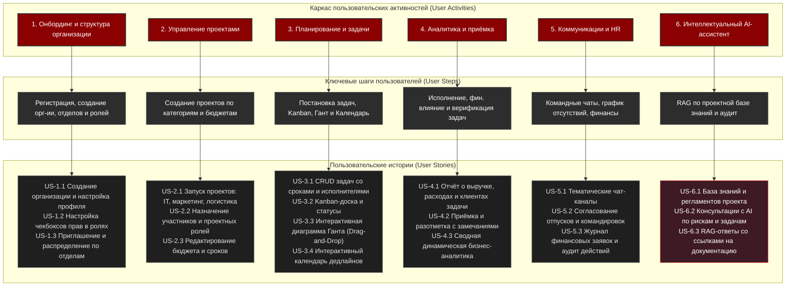

# Карта пользовательских историй (User Story Map) — Платформа «Сопрано»

> **«Сопрано»** — комплексная корпоративная экосистема управления организациями, проектами, задачами, командами и интеллектуальным AI-ассистентом с RAG-поиском.

---

## 1. Концепция и структура карты (User Story Map)

Карта пользовательских историй декомпозирует пользовательский опыт на **пользовательские активности (Activities / Эпики)**, формирующие каркас (Backbone), **шаги пользователей (User Steps)** и конкретные **пользовательские истории (User Stories)**, разделенные по релизам:
- **MVP (Минимально жизнеспособный продукт)** — базовый запуск организации, проектов, задач и ролей.
- **Release 1.1 (Интерактивность и аналитика)** — интерактивный календарь, диаграмма Ганта с перемещением строк, приёмка задач, финансовое влияние, RAG-документация.
- **Release 2.0 (Продвинутый AI и автоматизация)** — автономный AI-агент с выполнением инструментов, сквозная оптимизация ресурсов.

---

## 2. Диаграмма User Story Map (Mermaid)

---

## 3. Детализированная матрица историй по релизам

| Активность / Эпик | Шаг пользователя | MVP (Базовый релиз) | Release 1.1 (Интерактив и Аналитика) | Release 2.0 (AI и Автономия) |
| :--- | :--- | :--- | :--- | :--- |
| **1. Организация и роли** | Создание орг-ии и структуры | Регистрация, создание орг-ии, отделы | Матрица ролей с 6 гранулярными чекбоксами прав | Автоматический аудит привилегий сотрудников |
| | Управление командой | Приглашение по email, список сотрудников | Изменение ролей/отделов, скрытие кнопок по правам | Интеграция с корпоративным SSO / LDAP |
| **2. Проекты** | Запуск направления | Проекты с категориями (IT, HR, логистика и т.д.) | Полный CRUD проектов, управление бюджетами | Автоматическая оценка рентабельности проектов |
| | Формирование команды | Назначение сотрудников на проект | Индивидуальные проектные роли исполнителей | Балансировка рабочей нагрузки между проектами |
| **3. Задачи и таймлайн** | Управление задачами | Создание задач, приоритеты, дедлайны | Редактирование, удаление, привязка дат к календарю | Авто-декомпозиция сложных задач через AI |
| | Визуализация планов | Простой список задач и базовый Kanban | **Диаграмма Ганта**: Drag-and-Drop, кнопки `▲`/`▼` | Автоматический пересчёт критического пути |
| | Календарное планирование | Статический просмотр дат | **Интерактивный календарь**: клик и переход к задаче | Синхронизация с Google Calendar / iCal |
| **4. Контроль и приёмка** | Завершение задач | Смена статуса на «Выполнена» | Фиксация фин. влияния (+доход, -расход, клиенты) | Предиктивный скоринг выполнения задач |
| | Верификация качества | — | **Приёмка задач**: подтверждение и возврат с комментарием | AI-ревью соответствия результата регламенту |
| | Бизнес-аналитика | Базовая статистика орг-ии | Графики динамики выручки, затрат, задач и KPI | Интеллектуальный прогноз кассовых разрывов |
| **5. Корпоративные сервисы** | Внутреннее общение | Каналы чата организации | Удаление сообщений, фиксация авторства | Поиск по смыслу в сообщениях чатов |
| | HR и отсутствия | Заявки на отпуск/больничный | Модерация отсутствий, наложение на календарь | Авто-замещение сотрудников на время отпуска |
| | Финансовый контроль | Создание заявок на расходы | Двухэтапное утверждение финансов модератором | Экспорт отчётов в 1C / Excel |
| **6. AI-ассистент Soprano** | База знаний проекта | Загрузка документации (ТЗ, гайды) | Редактирование и удаление документов (RAG) | Автоматическое структурирование документации |
| | Консультирование | Базовые ответы по контексту | Поиск по регламентам, анализ рисков и статуса | Автономное выполнение действий с подтверждением |

---

## 4. Критерии приемки ключевых пользовательских историй (Acceptance Criteria)

### US-3.1: Редактирование и удаление задач
- **Given**: Пользователь имеет право `can_edit_tasks` или роль модератора.
- **When**: Нажимает кнопку «Редактировать» в карточке задачи или кликает по строке в диаграмме Ганта.
- **Then**: Открывается форма с предзаполненными полями (заголовок, описание, приоритет, исполнитель, даты, статус); после сохранения изменения немедленно отображаются во всех представлениях (список, Kanban, Гант, календарь).
- **And**: Кнопка «Удалить» запрашивает подтверждение и удаляет задачу из БД с обновлением счетчиков.

### US-3.3: Интерактивная диаграмма Ганта
- **Given**: Список задач проекта с датами начала и дедлайнами.
- **When**: Пользователь нажимает кнопки `▲` / `▼` или перетаскивает строку мышкой.
- **Then**: Порядок строк в диаграмме визуально меняется без перезагрузки страницы; состояние сохраняется в локальной сессии.

### US-1.2: Гранулярная матрица прав (чекбоксы ролей)
- **Given**: Модератор создал роль с выключенным чекбоксом `can_edit_tasks` и назначил её сотруднику.
- **When**: Данный сотрудник открывает проект.
- **Then**: Кнопка «+ Добавить задачу», кнопки редактирования и удаления задач полностью скрыты из интерфейса, а бэкенд блокирует прямые API-запросы с кодом `403 Forbidden`.
