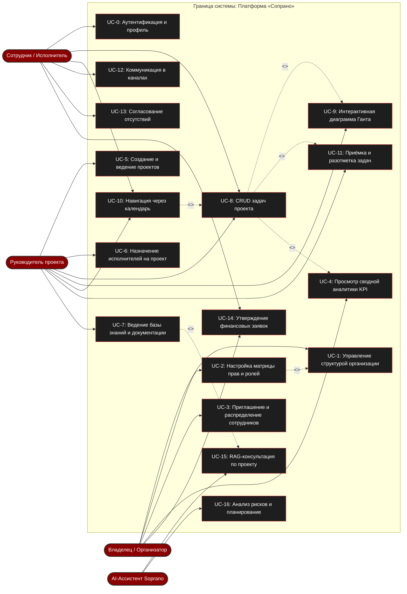

# Диаграмма прецедентов (Use Case Diagram) — Платформа «Сопрано»

> Документ описывает акторов (действующих лиц), границы системы и сценарии использования корпоративной платформы «Сопрано».

---

## 1. Акторы системы (Actors)

1. **Владелец / Организатор (Owner / Admin)**:
   - Обладает неограниченными полномочиями в организации.
   - Управляет настройками организации, матрицей ролей, отделов, финансовыми лимитами и критическими зонами.
2. **Руководитель проекта / Модератор (Project Manager)**:
   - Создаёт и ведёт проекты любой направленности (разработка, маркетинг, HR, логистика и т.д.).
   - Формирует проектную команду, распределяет бюджет, проверяет и утверждает выполненные задачи.
3. **Сотрудник / Исполнитель (Member / Specialist)**:
   - Исполняет назначенные задачи, отчитывается о результатах (включая финансовый эффект и привлечённых клиентов).
   - Подает заявки на расходы и планирует отсутствия (отпуск, больничный).
   - Взаимодействует в командных чатах и пользуется базой знаний.
4. **Единый AI-ассистент Soprano (AI Agent)**:
   - Интеллектуальный актор: индексирует документацию проектов, выполняет RAG-поиск, анализирует риски срыва сроков и предлагает оптимизационные решения.
5. **Системный администратор платформы (Superadmin)**:
   - Управляет пользователями системы, глобальными организациями и просматривает сквозной системный аудит-лог.

---

## 2. Диаграмма прецедентов (Use Case Diagram в Mermaid)

---

## 3. Спецификация ключевых прецедентов

### Прецедент UC-08: Управление жизненным циклом задачи (CRUD задач)
- **Основной актор**: Сотрудник с правом `can_edit_tasks` / Руководитель проекта.
- **Предусловие**: Пользователь авторизован и состоит в проекте.
- **Основной сценарий (Main Flow)**:
  1. Пользователь переходит на страницу проекта во вкладку «Задачи» или открывает Kanban-доску.
  2. Нажимает кнопку «+ Добавить задачу» (доступна только при наличии права `can_edit_tasks`).
  3. Заполняет заголовок, описание, даты начала и дедлайна, приоритет и выбирает исполнителя.
  4. Система валидирует даты и сохраняет задачу. Задача появляется в списке, Kanban, диаграмме Ганта и календаре.
  5. При необходимости пользователь нажимает «Редактировать» и обновляет любые параметры задачи.
  6. При нажатии «Удалить» система запрашивает подтверждение и удаляет задачу.
- **Альтернативный сценарий**:
  - У пользователя отсутствует право `can_edit_tasks` — кнопки добавления, редактирования и удаления задач скрыты; при попытке прямой отправки API возвращает `403 Forbidden`.

---

### Прецедент UC-09: Интерактивная диаграмма Ганта
- **Основной актор**: Руководитель проекта, Участник проекта.
- **Предусловие**: В проекте есть хотя бы одна задача со сроками.
- **Основной сценарий**:
  1. Пользователь открывает вкладку «Диаграмма Ганта».
  2. Система рассчитывает временную шкалу и отображает задачи в виде горизонтальных полос, окрашенных по статусу.
  3. Пользователь использует кнопки `▲` / `▼` или Drag-and-Drop для перестроения порядка отображения строк.
  4. Пользователь нажимает на полосу задачи — система открывает модальное окно редактирования задачи.

---

### Прецедент UC-11: Приёмка и разотметка задач
- **Основной актор**: Руководитель проекта (с правом `can_approve_tasks` или ролью модератора).
- **Предусловие**: Исполнитель завершил задачу и ввел бизнес-эффект (выручка, расходы, клиенты).
- **Основной сценарий**:
  1. Задача переходит в статус «Выполнена» (`completed`).
  2. Проверяющий видит отчет исполнителя и кнопки верификации.
  3. **Сценарий 1 (Подтверждение)**: Проверяющий нажимает «Подтвердить». Статус меняется на `approved`, фиксируется имя утвердившего.
  4. **Сценарий 2 (Возврат на доработку / Разотметка)**: Проверяющий нажимает «Разотметить», вводит причину возврата. Задача возвращается в статус «В работе» (`in_progress`), а замечание отображается исполнителю.

---

### Прецедент UC-10: Интерактивная навигация через Календарь
- **Основной актор**: Любой участник организации.
- **Основной сценарий**:
  1. Пользователь открывает «Общий календарь организации» или календарь проекта.
  2. Система отображает задачи, сгруппированные по дням дедлайнов.
  3. Пользователь нажимает на плашку задачи в ячейке дня.
  4. Открывается всплывающее окно с детальной сводкой задачи.
  5. Пользователь нажимает кнопку **«Перейти к задаче →»** — система осуществляет мгновенный переход на страницу проекта к выбранной задаче.

---

### Прецедент UC-15: RAG-консультация с AI-ассистентом Soprano
- **Основной актор**: Участник проекта / Руководитель.
- **Вторичный актор**: AI-Ассистент Soprano (LLM + векторный контекст).
- **Предусловие**: В проект загружены документы базы знаний (ТЗ, регламенты, инструкции).
- **Основной сценарий**:
  1. Пользователь открывает блок «AI-Ассистент проекта» и вводит запрос (например: *«Каковы критерии приемки по ТЗ модуля авторизации и какие задачи просрочены?»*).
  2. Система агрегирует текущий статус задач, бюджет и релевантные разделы проектных документов (RAG).
  3. AI-ассистент формирует структурированный ответ с прямыми ссылками на пункты документов и список рисков.

---

### Прецедент UC-02: Настройка матрицы прав и кастомных ролей
- **Основной актор**: Владелец / Модератор с правом `can_manage_roles`.
- **Основной сценарий**:
  1. Пользователь переходит во вкладку «Сотрудники и роли» и нажимает «+ Создать роль».
  2. Задает наименование роли (например, «Тимлид разработки», «HR-бизнес партнер»).
  3. Отмечает нужные чекбоксы прав:
     - `can_create_projects` (Создание проектов)
     - `can_edit_tasks` (Создание и редактирование задач)
     - `can_approve_tasks` (Приёмка и проверка задач)
     - `can_view_org_analytics` (Просмотр аналитики)
     - `can_manage_roles` (Управление ролями)
     - `can_manage_members` (Управление участниками)
  4. Сохраняет роль. Роль становится доступна для назначения сотрудникам в карточках управления участниками.
